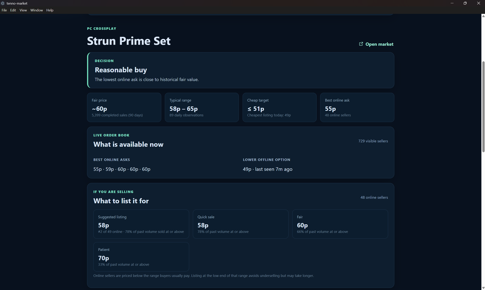
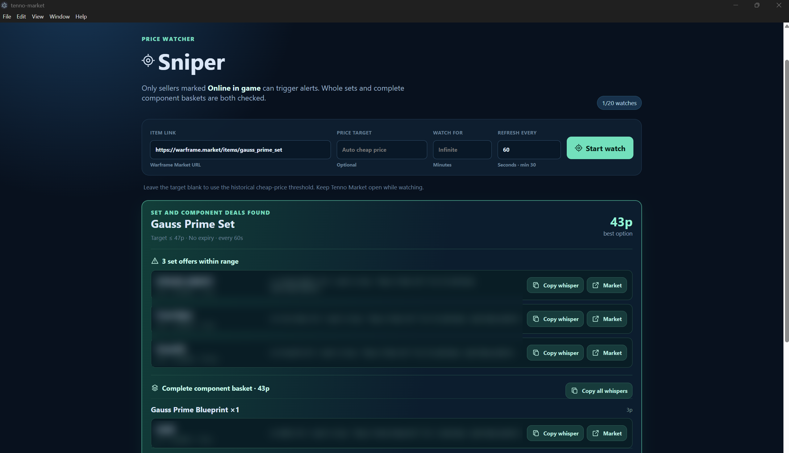
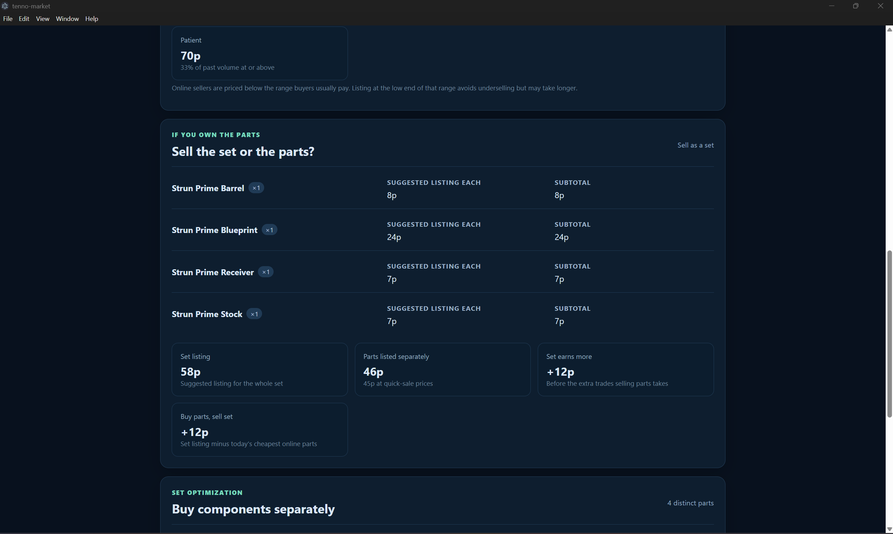

# Tenno Market

Modern Electron + React desktop app for live PC crossplay listings, 90-day completed-sale statistics, and set-part comparisons.



The **Sniper** tab keeps up to 20 item watches while the app is open. Choose a price cap or leave it blank to use the calculated cheap target, then set the refresh interval and expiry. Only **Online in game** sellers trigger alerts. Whole-set offers and complete component baskets are checked independently, with every qualifying offer and a copyable in-game whisper shown in the deal card.



## Project layout

```text
electron/   desktop app back end: API client, statistics, buy/sell advice, sniper (Node)
src/        desktop app front end (React)
cli/        command-line analyser (Python, buy side only)
tests/      unit tests for the app logic and the CLI
docs/       original product vision (roadmap, not current state)
builds/     local build output, not committed; download builds from GitHub Releases
```

## Run locally

Install dependencies once:

```powershell
npm install
```

Start the desktop app:

```powershell
npm run dev
```

## Build a downloadable Windows app

```powershell
npm run package
```

This writes a Windows ZIP to `builds/latest/`. Extract it, then run `Tenno Market.exe`. Paste a Warframe.market URL and select **Analyze**.

## Command-line fallback

```powershell
python cli/analyze_market.py https://warframe.market/items/strun_prime_set
```

Watch for a lower price or for an online seller to appear:

```powershell
python cli/analyze_market.py https://warframe.market/items/strun_prime_set --watch --target 55 --interval 60
```

Without `--target`, watch mode derives a conservative cheap target from the 90-day history. On Windows it plays a system alert sound; keep the terminal running. It alerts only when a seller first appears after none were online, or when price newly crosses the target.

Run checks:

```powershell
python -m unittest discover -s tests -v   # CLI analyser
npm test                # desktop app logic (market + sniper)
```

What it reports:

- **Fair price:** volume-weighted median of up to 90 days of completed-sale medians.
- **Typical range:** lower/upper quartiles of historical daily medians.
- **Cheap target:** conservative lower threshold; not a guarantee that a seller is available.
- **Buy now / reasonable buy / wait / expensive now:** comparison of the lowest online ask to historical sales and lower-priced offline alternatives.
- **Parts comparison:** uses the API's `quantityInSet` field, so repeated components are counted correctly. It shows each part's live ask, fair price, cheap target, offline alternative, and the buy-now/fair totals for the complete set.

## How the numbers work

Think of it as a stock screen for a game market. The 90-day history gives one row per day (median price, volume).

1. **Fair price** = volume-weighted median of the daily medians. A day with 40 trades counts 40 times, so thin days and one-off outliers barely move it. It is a median, so a single absurd day cannot drag it.
2. **Typical range** = 25th and 75th percentile of the daily medians (linear interpolation, same in the CLI and the app).
3. **Cheap target** = `min(0.85 × fair, 25th percentile)`, then lifted to the cheapest listing that exists today (online or offline) and capped at 97% of fair. A target below the market floor can never be bought, so it would never alert.
4. **Verdict** compares the lowest *online* ask with those numbers: at or below the cheap target is *Buy now*, within 3% above fair is *Reasonable buy*, otherwise *Wait if you can* (if a cheaper offline seller exists) or *Expensive now*. No history means no verdict.
5. **Sell advice** (app only) answers "what should I list it for?" from what buyers have actually paid. Quick, fair and patient prices are the volume-weighted 25th, 50th and 75th percentiles of daily medians, each shown with the share of 90-day volume that sold at or above it. The suggested listing is one platinum under the cheapest online seller, kept inside the quick-to-patient range so you neither undersell nor price above what buyers pay. If an online buyer's bid already reaches the quick-sale price, it is shown as an instant sale.
6. **Sell the set or the parts?** (app only) applies the same sell advice to every part and to the set, then compares the set listing with the parts' total. It also shows what buying the parts at today's cheapest online asks and selling the finished set would earn. Selling parts takes more trades, so a small gap favours the set.
7. **Component basket** (app only) fills each part's quantity from the cheapest in-game sellers, splitting across sellers when stock is short, and returns nothing if any part cannot be filled.



There is no moving average or forecasting: the statistics are descriptive, not predictive.

Limits:

- Live orders are listings, not confirmed trades.
- An offline seller's `lastSeen` timestamp does not predict when they will return.
- The sample intentionally targets PC with crossplay enabled. Do not compare its results with another market context.
- If the API has no 90-day series the app falls back to the 48-hour series and labels it as such.
- Thresholds (0.85, 1.03) are judgement calls, not fitted to data.
- Unofficial and not affiliated with warframe.market or Digital Extremes. The app waits 0.4 s between requests; keep it that way.
- The CLI and the app implement the same logic twice (Python and JavaScript), so changes must be made in both.
- Mods with several ranks share one history series, so their stats mix ranks.
- No data is stored locally except the sniper watch list; it uses the marketplace's current API data each run.

Data endpoints:

- `GET /v2/orders/item/{slug}` — current visible orders
- `GET /v2/items/{slug}/set` — set members
- `GET /v1/items/{slug}/statistics` — completed-sale history
